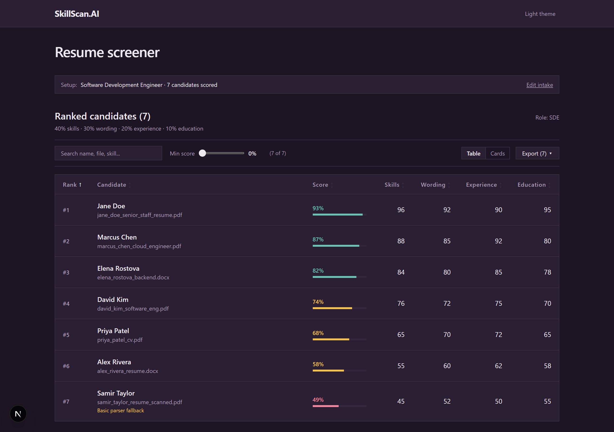
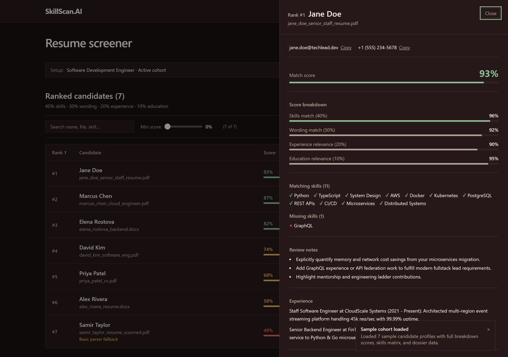
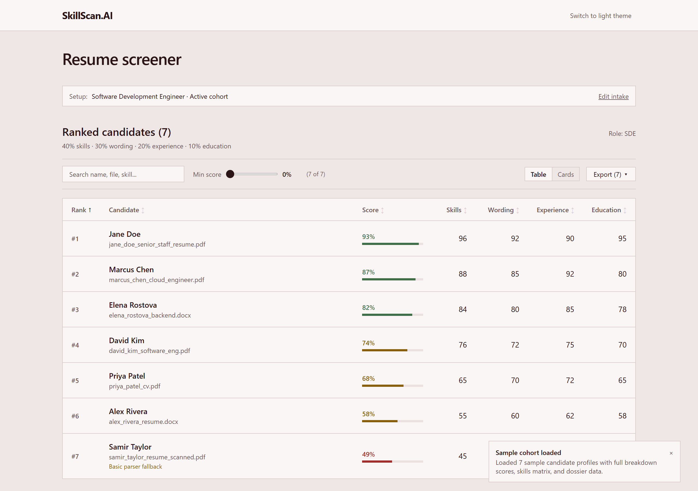
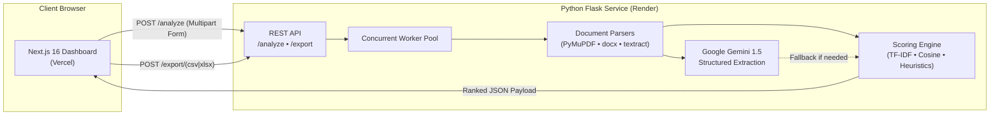

<div align="center">

# SkillScan.AI

### AI-Powered Resume Screening & Explainable Candidate Ranking

An enterprise-ready ATS screening dashboard that evaluates, ranks, and analyzes candidate resumes against job descriptions with multi-dimensional scoring transparency.

[](https://ai-powered-resume-screener-flame.vercel.app/)
[-black?style=for-the-badge&logo=next.js)](https://nextjs.org/)
[](https://react.dev/)
[](https://tailwindcss.com/)
[](https://flask.palletsprojects.com/)
[](https://ai.google.dev/)
[](LICENSE)

<br />

**[Explore Live Demo](https://ai-powered-resume-screener-flame.vercel.app/)** • **[API Documentation](#api-reference)** • **[Local Setup](#getting-started)** • **[Deployment Guide](#production-deployment)**

</div>

---

## Visual Preview

<div align="center">
  <p><strong>Ranked Candidate Table with Real-time Filtering & Metric Breakdown</strong></p>
  
</div>

<br />

<table align="center" width="100%">
  <tr>
    <td width="50%" align="center">
      <strong>Deep-Dive Candidate Drawer</strong><br/><br/>
      
    </td>
    <td width="50%" align="center">
      <strong>Accessible Light Theme</strong><br/><br/>
      
    </td>
  </tr>
</table>

---

## Overview

Recruiters and hiring managers spend an average of 6–8 seconds scanning a single resume. Traditional keyword-based Applicant Tracking Systems (ATS) frequently reject high-potential candidates due to minor wording discrepancies, while offering zero transparency into why a candidate was shortlisted or rejected.

**SkillScan.AI** solves this with an **explainable, multi-factor scoring engine** and a **quiet, data-dense interface**:
- Ingests multiple resumes (`.pdf`, `.docx`, `.doc`) simultaneously.
- Accepts job descriptions via text paste or file upload.
- Dissects applicant profiles across 4 transparent criteria: **Skills (40%)**, **Semantic Similarity (30%)**, **Experience (20%)**, and **Education (10%)**.
- Provides actionable deep-dives into matched/missing skills, candidate contact information, career history, and AI review notes.
- Exports filtered shortlists directly to CSV and Excel (`.xlsx`).

---

## Key Features

- **Transparent 4-Factor Scoring:** No black-box scores. Every applicant receives an explainable composite match percentage calculated from granular weighted sub-scores.
- **Concurrent Resume Parsing:** High-throughput document ingestion using a Python thread pool, supporting PDF, DOCX, and DOC formats.
- **Deep-Dive Candidate Drawer:** Slide-out drawer with a complete candidate profile: direct email/phone copy actions, checkmark/cross skill audits, work history, education degrees, and custom AI tips.
- **Data-Dense Minimalist UI:** Built with an "Oxblood & Bone" theme engineered for sustained recruiting workflows. Features tabular numerical alignment, responsive keyboard navigation, and zero distracting visual clutter.
- **Dynamic Sorting & Filtering:** Filter applicants on-the-fly by candidate name, filename, or minimum score threshold, and sort dynamically across any metric column.
- **One-Click Exporting:** Export custom-filtered applicant cohorts to formatted CSV or Excel workbooks (`.xlsx`) via the backend export service.
- **Resilient AI Pipeline with Offline Fallback:** Leverages Google Gemini for structured entity extraction, backed by an offline heuristic regex and TF-IDF fallback to guarantee 100% uptime even if API quotas fluctuate.

---

## Scoring Architecture

Candidate ranking is fully deterministic and explainable:

$$\text{Final Score} = 0.40 \times \text{Skills} + 0.30 \times \text{Semantic} + 0.20 \times \text{Experience} + 0.10 \times \text{Education}$$

| Dimension | Weight | Methodology |
| :--- | :---: | :--- |
| **Skills Match** | `40%` | Direct and keyword-boosted overlap between JD technical requirements and candidate verified skills. |
| **Semantic Similarity** | `30%` | TF-IDF vectorization and cosine similarity between complete resume prose and job description context. |
| **Experience Relevance** | `20%` | Quantitative extraction of candidate years of experience matched against senior/mid/junior JD seniority expectations. |
| **Education Relevance** | `10%` | Overlap of degree qualifications, academic disciplines, and recognized certifications against JD prerequisites. |

---

## System Architecture



---

## Tech Stack

### Frontend
- **Framework:** [Next.js 16](https://nextjs.org/) (React 19, App Router)
- **Styling:** [Tailwind CSS 4](https://tailwindcss.com/)
- **Typography:** [Hanken Grotesk](https://fonts.google.com/specimen/Hanken+Grotesk) (Tabular numbers, optimized via `next/font`)
- **Icons:** [Lucide React](https://lucide.dev/)
- **State Management:** React hooks + Safe LocalStorage persistence + Non-blocking Toast notification context
- **Hosting:** [Vercel](https://vercel.com/)

### Backend
- **Framework:** [Flask](https://flask.palletsprojects.com/) + Gunicorn
- **Language:** Python 3.11+
- **Parsing:** PyMuPDF (`fitz`), `python-docx`, `textract`
- **NLP / ML:** Google Gemini API, `scikit-learn` (TF-IDF Vectorizer), `nltk`
- **Data Export:** `pandas`, `openpyxl`
- **CORS:** `Flask-CORS`
- **Hosting:** [Render](https://render.com/)

---

## Repository Structure

```text
AI-Powered-Resume-Screener/
├── docs/
│   └── screenshots/              # Production UI captures (dark, light, drawer, mobile)
├── frontend/                     # Next.js 16 React frontend
│   ├── src/
│   │   ├── app/                  # App Router layout, metadata, globals.css
│   │   ├── components/           # UI components (Table, Drawer, Form, Header, etc.)
│   │   ├── context/              # Toast and Theme contexts
│   │   ├── hooks/                # Filtering and analytical state hooks
│   │   ├── lib/                  # API client, types, mock sample data
│   │   └── types/                # TypeScript type definitions
│   ├── package.json
│   └── next.config.ts
├── resume_app/                   # Flask REST API backend
│   ├── app.py                    # API routes, Gemini extraction, scoring logic, exports
│   ├── requirements.txt          # Python dependencies
│   ├── Procfile                  # Gunicorn deployment configuration
│   └── templates/                # Legacy HTML template (optional)
├── uploads/                      # Transient upload directory
├── README.md
└── LICENSE
```

---

## Getting Started

### Prerequisites
- **Node.js:** v18.18+ or v20+
- **Python:** 3.10+
- **Google Gemini API Key:** (Optional, but recommended for full AI extraction. Get one at [Google AI Studio](https://aistudio.google.com/))

### 1. Clone the Repository
```bash
git clone https://github.com/Neelanshdosi/AI-Powered-Resume-Screener.git
cd AI-Powered-Resume-Screener
```

### 2. Configure & Run Backend (Flask)
```bash
# Create and activate virtual environment
python -m venv .venv

# On Windows:
.venv\Scripts\activate

# On macOS/Linux:
source .venv/bin/activate

# Install Python dependencies
pip install -r resume_app/requirements.txt

# Create .env file with your Gemini API key (optional)
echo "GEMINI_API_KEY=your_gemini_api_key_here" > .env

# Start Flask server
python resume_app/app.py
```
> The backend will listen at `http://localhost:5000`.

### 3. Configure & Run Frontend (Next.js)
In a new terminal window:
```bash
cd frontend

# Install dependencies
npm install

# (Optional) Create local env file to point to your backend:
echo "NEXT_PUBLIC_API_URL=http://localhost:5000" > .env.local

# Run the development server
npm run dev
```
> The dashboard will be available at `http://localhost:3000`.

---

## Production Deployment

### 1. Backend on Render
1. Connect your repository to [Render](https://render.com/).
2. Create a new **Web Service**:
   - **Root Directory:** Leave blank (or root).
   - **Build Command:** `pip install -r resume_app/requirements.txt`
   - **Start Command:** `gunicorn resume_app.app:app`
3. In **Environment Variables**, add:
   - `GEMINI_API_KEY`: Your Gemini API key.
   - `CORS_ORIGINS`: Your Vercel frontend domain (e.g., `https://ai-powered-resume-screener-flame.vercel.app`).

### 2. Frontend on Vercel
1. Import your repository into [Vercel](https://vercel.com/).
2. In the setup wizard:
   - **Root Directory:** Click edit and select **`frontend`**.
   - **Framework Preset:** Next.js (auto-detected).
3. Under **Environment Variables**, add:
   - `NEXT_PUBLIC_API_URL`: Your deployed Render backend URL (e.g., `https://your-app.onrender.com`).
4. Click **Deploy**.

---

## API Reference

### `POST /analyze`
Uploads candidate resumes alongside a job description for screening.

- **Content-Type:** `multipart/form-data`
- **Parameters:**
  - `resumes`: Array of files (`.pdf`, `.docx`, `.doc`)
  - `jobRole`: Target job title (string, required)
  - `jobDescription`: Job description text (string, optional)
  - `jobDescriptionFile`: Job description document (file, optional)
- **Response:**
  ```json
  {
    "job_role": "Full Stack Engineer",
    "total_candidates": 12,
    "processed_at": "2026-11-13T10:00:00Z",
    "results": [
      {
        "candidate_name": "Jane Doe",
        "filename": "Jane_Doe_Resume.pdf",
        "rank": 1,
        "match_score": 94,
        "skills_match": 95,
        "semantic_similarity": 92,
        "experience_relevance": 96,
        "education_relevance": 90,
        "matching_skills": ["React", "TypeScript", "Python", "Docker", "Tailwind CSS"],
        "missing_skills": ["Kubernetes"],
        "keyword_score": 88,
        "details": {
          "Name": "Jane Doe",
          "Email": "jane.doe@example.com",
          "Phone": "+1 (555) 234-5678",
          "Skills": ["React", "TypeScript", "Node.js", "Python", "Docker"],
          "Education": ["B.S. in Computer Science"],
          "Experience": ["Senior Frontend Engineer (4 yrs)", "Software Engineer (2 yrs)"],
          "Projects": ["Open source design system", "E-commerce platform"]
        },
        "tips": ["Strong portfolio in full-stack web applications", "Consider evaluating cloud architecture experience"],
        "ai_error": null
      }
    ]
  }
  ```

### `POST /export/csv`
Generates a downloadable CSV spreadsheet from ranked candidate results.
- **Payload:** JSON array containing `results`
- **Response:** `text/csv` stream with `Content-Disposition: attachment; filename=candidates_summary.csv`

### `POST /export/xlsx`
Generates a formatted Excel spreadsheet from candidate results.
- **Payload:** JSON array containing `results`
- **Response:** `application/vnd.openxmlformats-officedocument.spreadsheetml.sheet` stream

---

## Contributing

Contributions, issues, and feature requests are welcome!
Feel free to open an issue or submit a pull request:

```bash
# Create your feature branch
git checkout -b feature/amazing-feature

# Commit your changes
git commit -m "feat: add amazing feature"

# Push to the branch
git push origin feature/amazing-feature

# Open a Pull Request
```

---

## License

This project is licensed under the [MIT License](LICENSE).

---

<div align="center">
  <sub>Crafted for modern recruiting teams with precision and data transparency.</sub>
</div>
